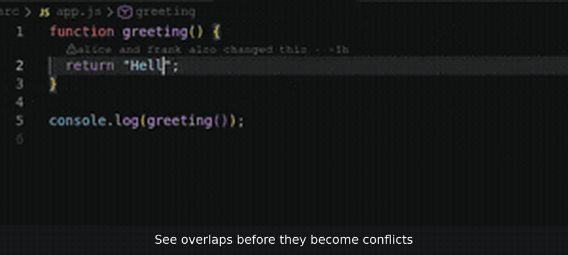

# TeamRope

**Git safety for hackathon teams: four buttons that keep everyone off main, out of each other's way and out of merge trouble before the deadline.**



## Install

- **VS Code:** search for **TeamRope** in the Extensions view, or run `code --install-extension teamrope-dev.teamrope`.
- **Cursor** (and other editors that use Open VSX): search for **TeamRope** in the Extensions view.
- **From a .vsix:** run `npm install && npm run build && npm run package -w teamrope`, then `code --install-extension packages/vscode/teamrope-0.1.0.vsix` (or use *Extensions → … → Install from VSIX*).

## The four actions

- **Start task**: gets the latest main and makes your own branch for the task.
- **Share changes**: commits and uploads to your own branch only, never to main.
- **Sync**: brings in the latest main, but only after a dry run shows it won't conflict.
- **Team status**: who is on which branch, who is behind main, and whose work overlaps.

Details, safety rules and settings: [packages/vscode/README.md](packages/vscode/README.md).

## Repo layout

```
packages/core     all Git logic and plain-English explanations (tested against real repos)
packages/cli      a thin command-line wrapper over core
packages/vscode   the VS Code extension, a thin UI over core
scripts/          broken-repo.sh builds a playground of broken test repos
```

Built in a week by a 16-year-old after his hackathon team broke their repo.

MIT licensed.
