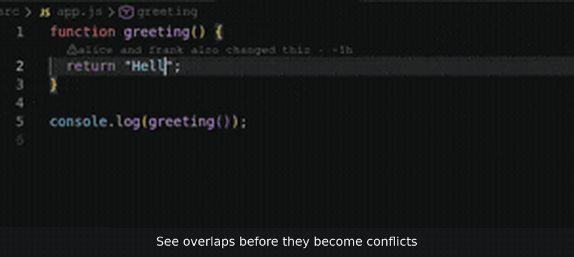

# TeamRope

**Git safety for hackathon teams: four buttons that keep everyone off main, out of each other's way and out of merge trouble before the deadline.**

Beginners on a hackathon team get lost in branches, commit straight to main and are afraid of merge conflicts. Then the final merge breaks an hour before submission, and the one person who knows Git spends that hour fixing everyone else's repo. Generic advice doesn't help, because it can't see your repo. TeamRope can: it looks at your real branches and your team's, and tells each person what to do next in plain English.

## The four actions

Open the **TeamRope** icon in the activity bar. The **You** panel says where you stand in one sentence and offers one button for the next step.

| Action | What it does |
| --- | --- |
| **Start task** | Checks that you can reach the team repo and that nothing is left unshared, gets the latest main, and makes your own branch for the task (like `alice/login-page`). |
| **Share changes** | Saves your work as a commit and uploads it to *your own* branch. If you started coding on main by mistake, it moves your changes to your branch first. Risky files like `.env` or `node_modules` are left out and explained. |
| **Sync** | Brings the latest main into your branch, but only after a dry run shows it combines cleanly. If it would conflict, nothing changes: you get the file names and who changed them instead. |
| **Team status** | Shows who is on which branch, who is behind main, and whose work overlaps, so you can talk before anything breaks. |

Every action shows its plan before it changes anything, and afterwards explains what it did and why in a sentence or two.

## How Team works

There is no server and no sign-up. TeamRope fetches your team repo and compares everyone's branches on your own computer:

- **Team** lists the problems first: work that would conflict with main, and two people changing the same lines. Each problem says who should do what, and **Copy message** gives you a ready-to-send text for your team chat.
- Below that, everyone on the team with their branch and when they last shared.
- **Activity** shows the latest commits across the team's branches, and **You** shows the last two hours as a small timeline.
- In the editor, files a teammate is also changing get a badge, and a note appears above the lines you both changed. Lines that would conflict with main are highlighted.

TeamRope only sees work that has been shared. Ask everyone to share changes every 30 to 60 minutes.

The team's captain can say so in the **Get started** walkthrough; the Team view then opens expanded for them.

## What it never does

- **Never pushes to main** and never merges into main. Getting work into main stays a decision people make together.
- **Never force-pushes.** If an upload is rejected, TeamRope tells you instead of overwriting anyone's work.
- **Backs up before moving anything.** Before a branch is moved, TeamRope saves where it was (under `refs/teamrope/backup/`) and tells you the backup's name, so the change can be undone.
- **Stops instead of guessing.** In the middle of a merge or rebase, or on a detached HEAD, it explains the situation and changes nothing.
- **Stays in your repo.** It never touches files outside the folder you opened.

TeamRope stays quiet until you open its panel or run one of its commands in a repo.

**No telemetry. No server. Everything runs locally with your own Git.**

## Requirements

- VS Code 1.90 or later, with the built-in Git extension enabled.
- Git installed. Git 2.38 or later makes conflict checks faster; older versions work too.
- A team repo with a shared branch called `main`, reachable as `origin`. Uploads and downloads go through VS Code's Git, so if you signed in to GitHub in VS Code, TeamRope uses that sign-in.

## Settings

| Setting | Default | What it does |
| --- | --- | --- |
| `teamrope.role` | `member` | `captain` opens the Team view expanded. |
| `teamrope.editorHints` | `true` | File badges, notes above shared lines and conflict highlights in the editor. The notification about a conflict with main still shows when this is off. |

## Feedback

Found a bug or something confusing? [Open an issue](https://github.com/aybaris901-integ/teamrope/issues).
